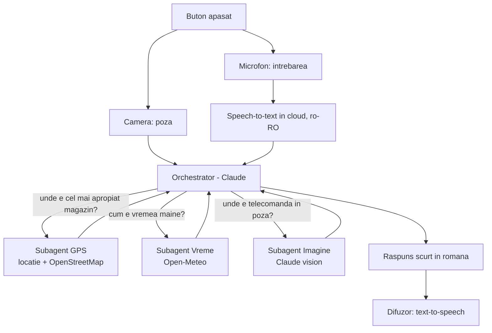

# Asistent vocal

This part of the project is separate from obstacle detection (`src/`).

The blind user presses a button in their hand. The camera takes a photo, the microphone
records a question, and the question + photo go to an **orchestrator** (Claude). The
orchestrator decides which **subagent** to ask, then the answer is spoken back.

Examples:
- "Unde e cel mai apropiat magazin alimentar?" -> **GPS** subagent
- "Va ploua maine?" -> **Weather** subagent
- "Unde e telecomanda in poza?" -> **Image** subagent

## Schema



## Main ideas
- The orchestrator receives **only the text** of the question. It sends the photo only
  to the Image subagent, so GPS and weather questions don't pay for sending an image.
- The answer is short (1-2 sentences) because it is read out loud.
- Only one program can use the Pi camera. Detection (`src/yolo_raspPi.py`) already uses it,
  so on the Pi the assistant will take the current frame from that script.

## Files
```
asistent/
  README.md          # this file: explanation + diagram
  requirements.txt   # libraries for this part
  config.py          # settings: model, location, button pin, language, laptop/Pi mode
  main.py            # button (Enter on laptop) -> photo -> listen -> orchestrator -> speak
  microfon.py        # asculta(): question from microphone -> text (Google, in the cloud)
  vorbire.py         # spune(text): text -> speaker (pyttsx3)
  orchestrator.py    # Claude decides which subagent to call
  subagenti/
    locatie.py       # where the person is (fixed coordinates for now, phone GPS later)
    gps.py           # closest places - Nominatim (OpenStreetMap), free, no key
    vreme.py         # forecast - Open-Meteo, free, no key
    imagine.py       # photo + question -> Claude vision
```

## How to run (on the laptop)
1. `pip install -r requirements.txt`
2. Set your Claude key: `export ANTHROPIC_API_KEY=...`
3. From the `asistent` folder:
   - test each subagent alone: `python -m subagenti.vreme`, `python -m subagenti.gps`, `python -m subagenti.imagine` (needs a `poza.jpg`)
   - test the orchestrator without the microphone: `python orchestrator.py`
   - the whole assistant: `python main.py`, press Enter, ask the question

On the Pi: set `PE_RASPBERRY = True` in `config.py`. For now it only works if
`src/yolo_raspPi.py` is not running, because only one program can use the camera.
